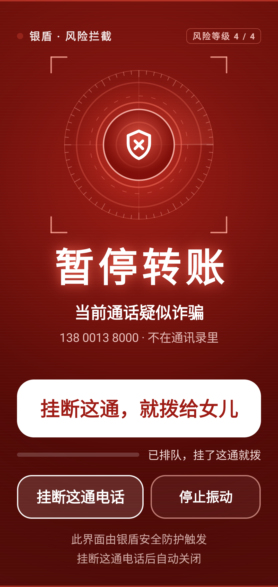
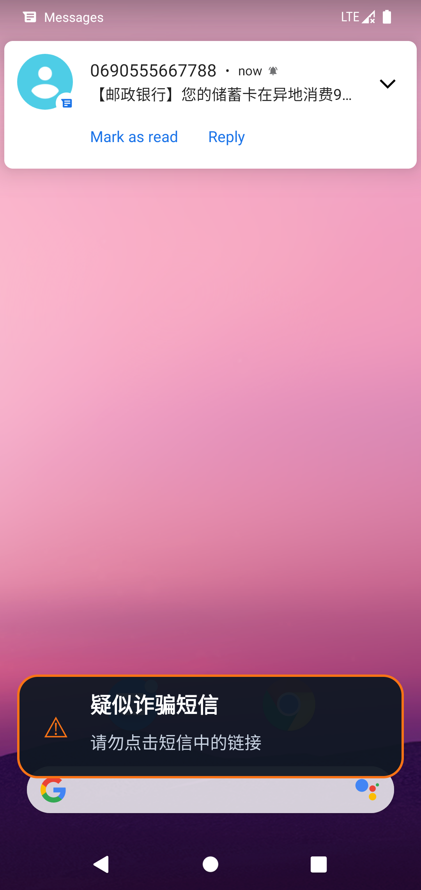
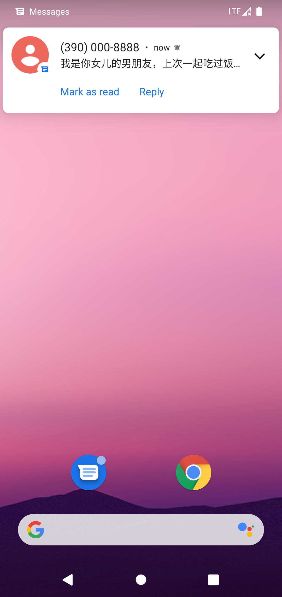

# 银盾 · 老年人反诈守护

一套装在两代人手机上的反诈系统：老人这台在**短信、微信、通话、手机银行**四个入口盯着，
判定有风险就当场提醒老人、同时把情况推给子女这台。

子女那台是**独立的 Android App**（`com.yindun.child`，界面叫「银盾家人」），
不是网页套壳：自己连着云端的实时流，收到告警就响铃、振动、弹通知，点开是时间线。

> 这不是概念稿。四个 App 都能装进真机跑，云端服务在跑，每一次判定都是规则引擎算出来的，
> 没有写死的假状态。文末「已知限制」把做不到的事一条条列清楚了，一条没藏。

> **2026-11 更新**：新增通话录音复盘、界面改版、规则 v3.5 与测试集、首次设置向导、子女端配对与鉴权。
>
> **2026-11-17 更新**：红屏上可以直接挂断这通电话（`endCall()` + 5 秒复核）；
> 同一号码 10 分钟内连发短信改为累计判定；词表去重（一句话里的包含词只算一次）。
> 接手开发请先读 [`docs/交接文档_后续开发.md`](docs/交接文档_后续开发.md)，模型相关见 [`docs/模型选型.md`](docs/模型选型.md)。

---

## 一、它盯着四个入口

| 入口 | 怎么盯 | 拦在哪一步 |
|---|---|---|
| **短信** | 系统短信广播 `SMS_RECEIVED` | 短信刚落地就判定，浮条提示「疑似诈骗信息」 |
| **微信** | 通知监听服务读通知正文 | 消息到达那一刻判定，同样弹浮条 |
| **通话** | 通话状态监听 + 号码身份识别 | 陌生号码响铃即通知子女；满 5 分钟弹复问卡；通话中收到验证码立即盖屏 |
| **手机银行** | 前台应用监听 | 通话中打开银行 App → 全屏红屏拦截，6 秒无人操作自动拨给子女 |

四个入口共用**一个判定引擎**，判定结果分四级：

```
watch 25 分   记一笔，不打扰
warn  45 分   弹浮条提示老人 + 推子女端
high  70 分   弹浮条 + 震动 + 推子女端
block 90 分   全屏盖住 + 持续震动 + TTS 语音 + 自动拨号
```

判定同时给出**诈骗阶段**，这是给子女看的关键信息——比"有风险"有用得多：

```
S1 套近乎(15) → S2 吓唬(25) → S3 隔离(40) → S4 要钱(45)
```

短信里出现「别告诉家里人」就是 S3，出现「安全账户」就是 S4。子女一眼能看出骗子走到第几步。

---

## 二、判定引擎怎么算的

`app/assets/rules.json` 与 `cloud/config/rules.json` 是同一份规则（v3.6）：

- **220 个关键词**：冒充公检法、钓鱼链接、客服退款、贷款刷单、投资理财、冒充亲友、中奖补贴
- **33 条反例**：银行通知、快递取件码、正常验证码话术——用来压分，防止把正常短信判成诈骗
- **链接形式识别**：不依赖词库，正文里出现 `http(s)://`、`www.` 或 `t.cn/xxx` 这类裸短链，
  直接 +20 分并推高到 S2。骗子故意不写"点击链接"四个字也躲不掉
- **发送方身份加权**：陌生号码 +15，服务号（95588、10086 这类）+0，通讯录 +0
- **验证码按发送方区别对待**：服务号发来的验证码是正常业务，不加分

引擎两份实现（Java 端 `Judge.java`、Node 端 `Judge.js`）跑同一份规则，
所以离线时手机自己判，联网时云端复核，结论一致。

举个实测的例子——一条最常见的 ETC 钓鱼短信：

```
【ETC】您的通行卡已停用，请点 t.cn/Etc7 认证，逾期注销
→ 逾期(+15) 已停用(+15) 注销(+12) 点击/点(+8) ETC(+10) 含链接(+20) 认证(-5)
→ 75 分 / S2 / high
```

原版词库（126 词，没有钓鱼链接这一类）这条只有 10 分，一声不响。

---

## 三、三个 App + 一个服务

```
app/                      银盾主 App（老人端 + 子女端同一份代码，按角色加载不同界面）
├── src/com/yindun/guard/ 24 个 Java 类，纯代码手写界面，无 XML 布局
├── assets/guard.html     老人端首页（深色极简「我在看着」）
├── assets/index.html     子女端网页（单页双视图：短信栏 / 通话栏，收到推送自动跳对应栏）
├── assets/rules.json     判定规则，双端共享
├── fakebank/             工商银行壳（包名 com.icbc.mobile），演示银行拦截用
└── fakewechat/           微信壳（包名 com.tencent.mm），演示微信诈骗消息用

cloud/                    Node + Express + MySQL 云端
├── src/Judge.js          与手机端同构的判定引擎
├── src/server.js         REST + SSE 实时推送
├── public/index.html     子女端网页（服务端版本）
├── config/rules.json     判定规则
└── sql/schema.sql        7 张表
```

两个壳的作用得说清楚：**它们只负责"产生一个真实的系统事件"**——银行壳被打开时是一个真的前台应用，
微信壳发消息时是一条真的系统通知。银盾那边读的是真通知、真前台包名，判定也走同一套规则引擎，
壳里**一行判定逻辑都没有**。

---

## 四、怎么跑起来

### 4.1 编译安装

需要 **JDK 17** + **Android SDK（compileSdk 34）**。SDK 路径通过环境变量给：

```bash
export ANDROID_HOME=/path/to/android-sdk   # Windows: set ANDROID_HOME=D:\Android
export JAVA_HOME=/path/to/jdk17
```

**首次构建需要联网**——Gradle 发行版从腾讯镜像拉（`gradle-wrapper.properties`），
依赖从阿里云镜像拉（`settings.gradle`）。只有拉过一次之后才能用 `--offline`。

```bash
cd app
./gradlew assembleDebug          # 产物 build/outputs/apk/debug/YinDun-debug.apk

# 或者不依赖 Gradle，手工打包（本项目一直两条路并存）
bash build2.sh                   # 产物 Yindun.apk
```

**两条路线产出的 APK 签名相同，可以互相覆盖安装**（实测三次往返 Success）。

#### 关于签名

仓库**不含签名密钥**（`*.jks` 在 `.gitignore` 里）。分两种情况：

- **没有 `app/local.properties`**（刚 clone 下来的默认状态）：
  Gradle 会用宿主机 `~/.android/debug.keystore` 自动签名，
  **构建能成功、APK 能装能跑**，只是不能覆盖安装已发布的旧版本。
  构建时会打印一段醒目提示告诉你这件事。
- **要项目自己的钥匙**：在 `app/local.properties` 里补四行（外加 SDK 路径）：

  ```properties
  sdk.dir=D\:\\Android
  yd.storeFile=yindun.jks
  yd.storePassword=******
  yd.keyAlias=yindun
  yd.keyPassword=******
  ```

  注意 `build2.sh` 也只认这四行，两条路线的钥匙必须一致，否则互相覆盖安装会失败。

#### 已知构建约束

**代码必须保持 Java 8 语法兼容**（不用 `var`、`List.of()`、switch 表达式等）。
原因：Gradle 用 Java 17 编译，而 `build2.sh` 走 `javac -source 8 -target 8` + `d8 --min-api 24`。
去掉这条约束需要先退役 `build2.sh`。

两个壳：

```bash
bash app/fakebank/build_bank.sh      # BankDemo.apk
bash app/fakewechat/build_wechat.sh  # WechatDemo.apk
```

装好后要手动给四个权限，缺一个就有一条防线失效：

1. 短信权限（收短信，用于实时判定）
2. 悬浮窗权限（弹浮条、盖红屏，没有它所有提醒都出不来）
3. 通知使用权（读微信消息）
4. 使用情况访问权限（识别前台是不是银行 App）

### 4.2 云端

```bash
cd cloud
npm install
cp .env.example .env        # 填数据库地址、账号、端口
mysql -u root -p < sql/schema.sql
node src/server.js
```

需要 MySQL。Redis 可选（没有就降级为单机内存），华为云 MaaS 大模型可选
（跑的是 DeepSeek，用于灰区复审；没有就只靠本地规则）。

`.env` 模板在 `.env.example`，**仓库里不含任何真实账号密码**。

### 4.3 签名说明

见上面 [4.1 的「关于签名」](#关于签名)。一句话：**没有密钥也能构建成功**，
用的是宿主机默认 debug 钥匙；要覆盖安装已发布版本才需要配 `local.properties`。

本项目实际使用的钥匙签名为 `SHA-256 1e10dabe…ddc2`，
两条构建路线打出来的 APK 都是这一把，所以能互相覆盖。

---

## 五、现场演示怎么走

完整脚本见 [`docs/演示步骤.md`](docs/演示步骤.md)，四步大约 5 分钟：

1. **微信诈骗**：打开微信壳 → 消息自动到达 → 屏幕下方弹「疑似诈骗信息 / 请谨慎点击短信链接」
2. **短信诈骗**：发一条 ETC 钓鱼短信 → 系统通知 + 银盾浮条同时出现
3. **通话诈骗**：陌生来电 → 响铃卡点「不认识」→ 满 5 分钟复问卡（持续振动）→ 再点「不认识」自动拨给子女
4. **转账拦截**：通话中打开工行壳 → 全屏红屏 + 震动 + TTS + 6 秒后自动拨号

子女端网页全程同步：短信走短信栏、电话走电话栏，收到推送自动切到对应视图。

### 现场画面

> 以下三张摄于 **Android 11 模拟器（x86_64）**，不是真机实拍。界面与真机验证的是同一条代码路径；
> 模拟器没有 ARM 原生库，端侧 TinyBERT 会主动降级、只走规则引擎（真机 arm64 正常加载模型），
> 不影响判定链路与拦截行为。

| | |
|---|---|
|  | **通话中打开手机银行 → 全屏拦截**<br>风险等级 4/4，大字`暂停转账`，显示来电号码与"不在通讯录里"；主按钮`挂断这通，就拨给女儿`，6 秒无人操作自动拨号。 |
|  | **诈骗短信 → 浮条**<br>浮条刻意贴屏幕下方，避开系统自己的通知横幅。两条同屏时上面是"来短信了"，下面是"这条是诈骗"。 |
|  | **只到 watch 级 → 不打扰**<br>本地仅 15 分的短信不弹浮条，只上报、留给子女端判断。避免老人被误报烦到去关悬浮窗权限。 |

---

## 六、已知限制（这些做不到，别在答辩时被问倒）

| 限制 | 原因 | 现在的做法 |
|---|---|---|
| ~~**不能自动挂断电话**~~ | ~~Android 没有给第三方 App 挂断他人通话的权限~~ —— **这条 2026-11-17 被推翻了** | Android 9 起 `TelecomManager.endCall()` + `ANSWER_PHONE_CALLS` 就能挂断一通不是自己拨的电话，不需要系统签名。但个别 ROM 会"收下请求却不执行"，所以挂完 5 秒复核，没断就如实告诉老人并交还操作权（真机 EMUI 9.1 实测能挂断） |
| **微信只能读通知，读不到聊天记录** | 需要无障碍读全屏文字，误报高、费电、隐私讲不清 | 覆盖"消息到达那一刻"。老人正开着聊天窗口时微信不发通知，这是盲区 |
| **不能替老人在微信里转发** | 微信没有对外接口 | 判定到 warn 以上自动推子女端，不需要老人操作 |
| **银行靠包名/标题白名单** | 没有银行 App 的接口 | 内置主流银行包名表，装新银行需要扩表 |
| **语音是 TTS 合成** | assets 里没有预录音 | 用系统 TTS 念固定话术 |
| **国产 ROM 会杀后台** | 各家省电策略不同 | 已申请前台服务和电池优化白名单，仍需要用户手动加锁 |
| **模拟器演示的三个"模拟"** | — | 短信由 adb 注入、来电由模拟器注入、微信和银行是壳。除此之外的链路全是真的 |

最后一条要特别说明：短信是真的进了系统短信库、通知是真的、判定是真的、浮条是真的，
只有"谁按的发送键"是模拟的。真机上换成另一部手机发就行，代码一行不用改。

---

## 七、目录里的东西

```
docs/SFT接入计划.md          ★ 小模型接入线上 + 第四轮训练的执行计划（2026-11-24 起按这份做；第一条线已打通，线上现在三票）
docs/LoRA微调实验_20261123.md  ★ 最新研究线记录：三轮 LoRA 对照实验的完整过程、结果与错例分析（老师请先看这份）
docs/第四轮基线_TAF200_20261124.md  ★ 第四轮的新测试集与基线（诈骗 100 + 正常 100，原始模型两口径）
docs/短文本100_写作说明.md  ★ 第四轮第二套考题的人工撰写说明（50 诈骗 + 50 正常，填空表在 r4/ 下）
docs/交付文档.md      完整交付说明：功能矩阵、判定链路、验证记录、部署步骤
docs/演示步骤.md      现场演示脚本，一步一步照做
docs/码道补丁清单_v1.md  交给华为云码道 CodeArts 执行的改动清单（见交付文档第六节）
docs/交接文档_后续开发.md  本轮改动、运行与测试、已知问题、下一步计划（接手先读这份）
docs/模型选型.md      用了哪些模型、为什么、怎么配置、计划训练的模型
docs/SFT接口说明.md   AntiFraud-SFT 校内 GPU 接口：地址、请求/响应格式、实测数据
docs/SFT接入记录.md   银盾侧怎么接：第三票定位、只抬不降的融合规矩、接完实测
docs/GPU容器SSH使用说明.md  学校 GPU 容器 SSH 登录、共用规则、备份与恢复（微调用）
docs/改造方案.md         去掉 DeepSeek、SFT 做核心（反向隧道）、RDS/DCS/OCR 与 CodeArts 部署：分阶段步骤与验收
docs/通话录音复盘.md  通话录音复盘功能的设计与测试
docs/规则测试与配对.md  规则 v3.5 测试集、首次设置向导、子女端配对与鉴权
docs/真机验证清单.md   8 步真机验收清单，含短信同号累计、红屏挂断三种结果的实测记录
release/              四个已签名的安装包，可直接装
LICENSE               开源许可证（MIT）
```

开发过程里用到了华为云码道 CodeArts 智能体（改前端演示页），
用的是「先拆成增量清单、再交给智能体执行」的方式，细节和证据在交付文档第六节。

---

## 八、版本

- App `1.0.0-rc2`（versionCode 3，minSdk 24 / targetSdk 34）
- 规则库 `v3.6`（220 词 + 33 反例 + 11 组合规则 + 3 条永不告警白名单）
- 云端 `1.0.0`（Node 18+ / MySQL 8）

---

## 九、开源许可证

本项目采用 **MIT 许可证**，全文见 [LICENSE](LICENSE)。

选择的理由：这是一件面向公众的反诈工具，用的人越多越有意义。
MIT 只要求保留版权声明，允许任何人自由使用、修改、再分发，
也允许商业机构拿去集成——对这类公益属性的软件，传播比控制重要。

如果要用于专利相关的场景，可以改判 Apache-2.0（多一条专利授权条款）。
